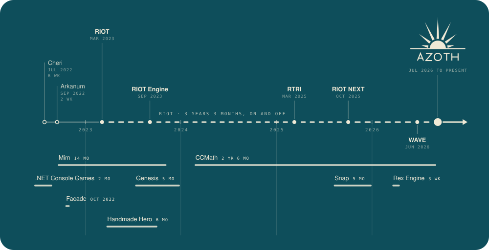

# Azoth Engine

Azoth is a closed-source game engine built by Ian Pike. Parts of it have been made publicly available to support research and academic endeavors and to showcase the techniques it uses.

We hope people can learn how engine systems are built by reading real, working code. As it comes from Azoth itself, students and hobbyists can also build on what they study. To make that easier, each part is a standalone library. Contributions are welcome, as any improvement helps both the engine and its readers.

## History

Azoth is the result of more than four years spent building game engines from scratch. The work began in July 2022 with a first C++ engine. It took the RIOT name in March 2023 and continued on and off for three years across several projects before it grew into Azoth.

